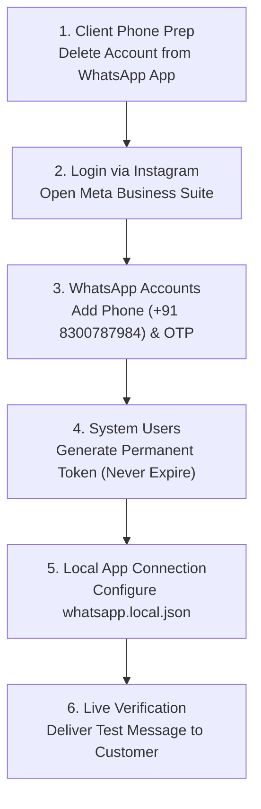

# Meta WhatsApp Cloud API — Live Onboarding & Deployment Guide
**Project:** That Waffle Place  
**Entity:** S4 HOSPITALITY  
**Target WhatsApp Sender:** +91 8300787984  
**Instagram Profile:** `@that.waffle.place`  

---

## Overview Workflow



---

## Phase 1: Client Phone Preparation (Mobile Device)

> [!IMPORTANT]
> **Meta Rule:** A phone number cannot run on both the consumer WhatsApp smartphone app and the Cloud API simultaneously.

1. **Backup (Optional)**: If the client has important chat history on `+91 8300787984`, export chats via **Settings → Chats → Chat backup**.
2. **Delete Mobile Account**:
   - Open WhatsApp or WhatsApp Business on the phone containing SIM `8300787984`.
   - Go to **Settings** (top right 3 dots on Android / bottom right gear on iPhone).
   - Tap **Account** → Tap **Delete account** (at the bottom).
   - Type phone number `8300787984` and confirm **Delete account**.
3. **Status Check**: The app will reset to the *"Welcome to WhatsApp"* screen. **Do NOT register or log in again on the phone.** The SIM remains active for regular voice calls and standard SMS.

---

## Phase 2: Login to Meta Business Suite via Instagram

1. Open your browser in Incognito or a clean profile.
2. Go to: **[https://business.facebook.com](https://business.facebook.com)**
3. On the login screen, click **"Continue with Instagram"**.
4. Enter the Instagram credentials for:
   - **Username / Handle**: `that.waffle.place`
   - **Password**: `[Client Instagram Password]`
5. Once logged in, select the Business Portfolio: **`Thatwaffle place`** *(Portfolio ID: `1626446091864559`)*.
6. Click the **Gear icon (Settings)** at the bottom-left of the screen.

---

## Phase 3: Add & Verify the Phone Number (+91 8300787984)

1. In the left navigation sidebar:
   - Expand **Accounts** → Click **WhatsApp accounts**.
2. Select your WhatsApp Account (`Thatwaffle place`, ID `1609076811021416`).
3. Click the **Add phone number** button *(or click the `...` three dots next to Phone number information)*.
4. Fill in the profile details:
   - **WhatsApp Business Display Name**: `That Waffle place!`
   - **Category**: `Food & Beverage` or `Restaurant`
   - **Business Description**: `Waffles, shakes, and desserts in Chennai.`
5. Enter the phone number:
   - Country Code: **India (+91)**
   - Phone Number: **`8300787984`**
6. Verification Method:
   - Choose **Text message (SMS)**.
   - Click **Next**.
7. Have the client check the phone with SIM `8300787984` for the **6-digit SMS code from Facebook/Meta**.
8. Enter the 6-digit code and click **Verify**.
9. Once verified:
   - The status changes to **Connected / Active**.
   - Note down the **15-digit Phone Number ID** displayed in the table (e.g., `103829472910482`).

---

## Phase 4: Create System User & Generate Permanent Token

> [!NOTE]
> Temporary tokens in Graph API Explorer expire in 24 hours. A System User token **never expires**, guaranteeing 24/7 automated delivery.

1. In the left navigation menu under **Users**, click **System users**.
2. Click **Add** (top right):
   - **System user name**: `twp_api_user`
   - **System user role**: `Admin`
   - Click **Create system user**.
3. Under the newly created `twp_api_user`, click **Assign assets**:
   - Go to **WhatsApp accounts** → Check `Thatwaffle place`.
   - On the right toggle column, enable **Full control** *(Manage WhatsApp account)*.
   - Click **Save changes**.
4. Click **Generate new token**:
   - **Select App**: Choose your Meta App.
   - **Token expiration**: Select **Never**.
   - Under Permissions, check these 2 required scopes:
     - `whatsapp_business_messaging`
     - `whatsapp_business_management`
   - Click **Generate token**.
5. Copy the generated token immediately *(it starts with `EAA...`)* and save it securely.

---

## Phase 5: Connect Credentials to Local System

### Method A: Via Web Dashboard (Instant)
1. Open in your browser: **`http://localhost:8080/api/send-whatsapp`**
2. Paste:
   - **Meta Access Token**: `EAA...`
   - **Phone Number ID**: `[15-digit number from Phase 3]`
3. Click **Save & Switch to Live Mode**.

### Method B: Via File (`whatsapp.local.json`)
Create or edit `c:/Users/ashok/OneDrive/Desktop/project/thatwaffle/whatsapp.local.json`:
```json
{
  "token": "EAAG...",
  "phone_number_id": "103829472910482",
  "delivery_mode": "twp_offer_broadcast"
}
```
*(This file is automatically protected by `.gitignore` so secrets are never pushed).*

---

## Phase 6: Live Message Testing & Verification

1. On **`http://localhost:8080/api/send-whatsapp`**:
   - Under **Recipient Phone**, enter your test phone number (e.g. `918056448118` or `918300787984`).
   - Under **Message / Template**, enter a greeting or test text.
   - Click **Send WhatsApp**.
2. Check the response log:
   - Expected status: `HTTP 200 OK`
   - Response payload: `{"messages": [{"id": "wamid.HBgL..."}]}`
3. Check the recipient's phone — the message arrives directly from **`That Waffle place!`**.

---

## Quick Reference Summary

| Field | Production Value |
|---|---|
| **Status** | **ACTIVE & VERIFIED (`meta_live`)** |
| **Meta Business Portfolio ID** | `1626446091864559` |
| **WhatsApp Business Account (WABA) ID** | `1450318450622796` |
| **Official Store Phone** | `+91 80564 48118` |
| **Verified Display Name** | `Thatwaffle place` |
| **Phone Number ID** | `1465237300010288` |
| **Meta App ID** | `1449920199851529` |
| **Local Config File** | `thatwaffle/whatsapp.local.json` |
| **Local Web Interface** | `http://localhost:8080/api/send-whatsapp` |
| **Admin Studio** | `http://localhost:8080/admin` |
